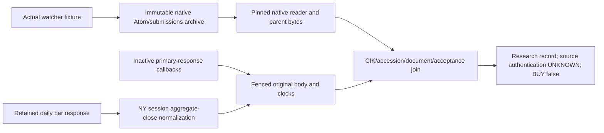

# Native primary-response join and retained close — inactive checkpoint, 5 November 2026

CATALYST-03 / MARKET-03 / EXEC-03 development only. Base **572dc5aeacb1f10d4590123432e4203cd0d347e2** is preserved. Claude is independently reviewing that earlier collector/fence package. Ownership coordination: PR1 comment6661909569. Its modules, native producer, scanner, watcher, policies and workflows remain byte-identical; this package composes their existing APIs. No provider request, credential, collection, installation or production change is authorized or performed.

## Bounded result

| Stage | Implementation / proof | Limit |
|---|---|---|
| Actual watcher → native archive | Existing production-capsule fixture runs watcher shadow off/on; requests, snapshots and legacy decision rows remain identical (5 mocked provider requests each). Actual `appendNativeResponse` / `appendNativeSubmissions` producer outputs are read by `readNativeRun`. | Synthetic loopback services and pinned inactive shadow patch. This is not a deployment, real SEC access or authentic prospective evidence. |
| Archive → source join | `a-native-source-join.mjs`: original Atom entries, complete original response envelopes, submissions and pinned parent bytes are retained through the existing fenced store. SHA256 joins original bytes, not a URL/hash-shaped assertion. | A direct response URL match establishes metadata consistency only. It does not authenticate TLS, the collector, a primary claim, or the source's truth. Overall source authentication and execution eligibility remain UNKNOWN. |
| Primary transport → retained body | `createPrimaryResponsePort`: explicit begin/headers/body callbacks, phase clocks captured before disk work, immutable original body/envelope, uncertain-write replay retains the same original receipt clock. Restart instance IDs cannot overwrite earlier responses. | No network client or endpoint is activated. The existing producer does **not** fetch/retain the primary filing document. The port consumes handed-over bounded bytes; its caller must supply an independently reviewed bounded transport before live use. It does not authorize adding an Archives request. |
| Source identity and acceptance | Official submissions route, issuer CIK, accession, form, `primaryDocument` and exact Archives path must agree. Accession submitter digits need not equal issuer CIK. Acceptance comes only from the retained matching SEC submissions row, with explicit zone and non-future nanosecond ordering. | Atom `updated` remains `reportedAtomUpdatedAt`, never acceptance. Missing/late/conflicting proof stays UNKNOWN/research only; no backdating or changed enrollment. |
| Durable lineage/revisions | Exact duplicates are idempotent; first observations and first conflicts are immutable. First primary/proof baselines persist even if the first join lacked them. Revision/reversion, restarted readers, competing processes, real SIGKILL and partial recovery are exercised. | Available pinned parent lineage is not global run history or first-ever ingestion. Incomplete archive/earlier-history uncertainty is retained. No admitted case is created. |
| Close source | `a-close-source.mjs`: retained actual-format single-symbol Alpaca daily bars, explicit raw adjustment, original receipt and bar timestamp, NY session/DST/early close, symbol/identity, pagination/empty/malformed distinctions, persistent revision state. | Daily bar `c` is an aggregate close, **not** an official auction print or executable fill. Query `feed=sip` is not response-specific feed or entitlement proof. Volume is bar-derived, not independently verified total traded volume. Close finality/execution contract remains unadopted. |

## What the actual producer can and cannot provide

The existing feed tee can preserve the original Atom response and `<entry>` bytes, reported ID, accession, issuer CIK, form/items, request/header/body/observation clocks, submissions response and explicit `acceptanceDateTime` when that response exists. It cannot derive primary document contents from an Atom item number. The actual producer order commonly observes Atom before the safety submissions response; late acceptance is explicitly retained as late research context. No reorder, request, enrollment change or invented acceptance is included here. The actual-watcher regression confirms the missing primary is UNKNOWN, then joins a separately labelled synthetic document delivered through the response port without changing watcher requests.

A matched structural join is labelled `MATCHED_RESEARCH_ONLY`, never authenticated/approved. `sourceAuthentication: UNVERIFIED`, `globalFirstIngestionEstablished: false`, `executionEligibility: UNKNOWN`, `allowBuy: false` and zero genuine admissions are explicit. No new signature, root, owner confirmation or ZAD validity is invented. Material-contract/dilution/resale interpretation remains unverified: matching a document path/body is not semantic proof of its contents.

The follow-up close regression is retained red against1e629bc7: changing response field order/adding an unrelated day falsely created a close revision. The corrected fingerprint uses the requested session's actual bar values, while keeping all original body bytes. A changed target-day value still creates a permanent conflict. Primary response lists are ordered by their original nanosecond receipt clocks before selecting the first retained baseline; input array order cannot pick a later revision as first.

## Failure/recovery contract

Original response bodies and envelope clocks are immutable. Exact duplicate body arrivals retain distinct envelopes when their clocks differ; event joins preserve the first context, not the restart time. Nanosecond comparisons do not round a future acceptance into the observation window. Malformed neighboring submissions rows do not suppress a valid matching row; a malformed matching row remains unresolved.

First/conflict markers are committed before later body imports. A committed conflict survives an interrupted import and a reverted value. Any uncommitted fenced intent blocks join/close completion until **explicit existing fenced recovery**. There is no automatic recovery, stale-lock removal, truncation, original replacement, acquisition retry or promotion. A port whose write is uncertain retains its exact pending body/clocks in memory for identical replay; after a process loss, original bytes/context must be retained externally or the response remains unresolved. A signed or local durable record is not a remote upload receipt. Concurrent contenders receive a bounded kernel-lock refusal; the test resumes only after the competing processes have terminated.

Response-port caps: at most100 starts per instance, body at most2MiB; no implicit restart reconnect or global quota claim. Native reader caps remain unchanged. The existing fenced store's **16MiB total /2000 files** remains the effective hard limit, including copies, envelope/base64 overhead, journal and metadata. A maximum-size native parent may therefore exceed this store's available capacity: the operation fails unresolved and preserves evidence. This package does not raise any approved acquisition/storage budget. Retained input/provider execution and authentic transport/session completeness remain separate prerequisites.

Close normalizations carry original availability (`bodyReceivedAt`), the source bar's timestamp, and a separately **calendar-derived** session close boundary. The latter is neither a source publication timestamp nor a guarantee the bar has settled. Unknown years/sessions, holidays/weekends, wrong symbols, partial pages, invalid prices/times, unsupported adjustment and pre-close responses fail closed. No evaluator or live strategy input imports this proposed adapter.

## Inherited independent review findings (not silently waived)

Claude's published review of572 is [446cd250bfe1aba6e8e5b949223d5fe4732cb9d2](https://github.com/drrazaq/Stock-2/blob/446cd250bfe1aba6e8e5b949223d5fe4732cb9d2/docs/review-572dc5ae/README.md), PASS WITH FINDINGS for offline engineering, authenticated integration MISSING. K1: a lost original leaves an unrecoverable pending intent/new-generation blockage while generic old-token appends remain possible. K2: interrupted claim residue requires identical parameters; a different claim is refused. This checkpoint preserves the reviewed modules byte-for-byte, makes its own join/close entrypoints refuse pending intents, and does not claim to repair generic-store K1/K2 or authorize their proposed terminal disposition. Tokens are not credentials; a protected exclusive host boundary remains necessary. SIP continuity is subscriber continuity, not a provider no-loss guarantee. These are inherited review findings, not failures of newly collected market evidence. Follow-up store changes require a separate bounded engineering/review checkpoint, without live use meanwhile.

## Verification, review and resume

[Verification record](verification.json) records executed commands, including the initial fault-injection harness error and its correction without relaxing assertions. [Manifest](manifest.json) pins the exact inactive source/tests and inherited protected dependencies. The package-hash test verifies those bytes and confirms no production caller imports either module. Terminal exact-commit hosted evidence and Claude's requested independent review are published on PR1; they are separate evidence categories.

Original40 acceptance criteria remain unchanged: **24 accepted /16open;0closures and0prospective admissions**. CATALYST-03 advances the native/primary byte and clock join; MARKET-03 advances explicit close/feed/basis normalization; EXEC-03 advances an explicitly unresolved close-source contract. REPO-03/ACTIONS-04 receive only component failure/concurrency evidence, not full-row completion.

**Next executable task after review:** address concrete review findings in this exact join/close package, then connect the verified retained inputs to the unchanged strict A evidence importer under an explicit reviewed close-source contract. Actual primary-response acquisition/transport, authenticated capture/trust roots, complete earlier-run history, source/cost/close policy adoption and any setup/rehearsal/activation remain separately gated. Do not fetch a filing merely to make the join appear complete. No proposed ZAD policy or90-day non-halal exclusion is changed.
