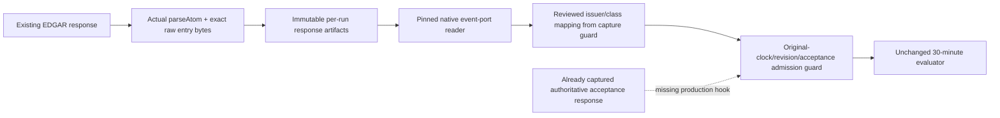

# Native SEC evidence continuation — inactive

Prepared31October2026. The earlier description of native-event production and live bindings as only external/activation dependencies was wrong. They are **implementation gaps**. This checkpoint implements the native adapter, artifacts and reader, and prepares an isolated shadow patch. It does **not** implement or activate the separate live capture host. [Live implementation scope](validation/paper-capture-live-scope.json), [canonical request budget](validation/paper-capture-request-budget.json).

The six names,09:30–09:34enrollment,30-minute evaluator, fees/slippage and exit remain unchanged. Calibration on5November remains an unapproved proposal. Original artifact audit0admissions, LEADER DIP NOT PROVEN, acceptance24/40. No production file/workflow was changed or executed.

## Actual producer audit

Audited `edgar-feed.mjs::parseAtom` and `ignition-watch.mjs::pollEdgar` at production base `d710db7e5a2f8bfcff84aa4aa124f3cc4e1d2a6f` and development5159ce2. Existing polling selects8-K/6-K, approximately110seconds apart, until11:00NY, with up to16pages on first poll and4later. None of those existing requests is increased by the proposed tee.

| Requirement | Available today? | New handling / exact gap |
|---|---|---|
| Original Atom entry/body bytes | Fetch response exists transiently; current caller consumes `.text()` and discards bytes | Proposed tee consumes that same response once via `.arrayBuffer()` and preserves its bytes, then decodes text exactly as the legacy path. These are bytes delivered by Fetch, not compressed TCP/wire bytes. No historical bytes are reconstructed. |
| Accession, CIK, role, form, original Atom ID | Parsed from title/ID/summary | Reuse actual `parseAtom`, retaining raw entry spans/byte offsets and original ID. No ticker/CIK inference from price or missing metadata. |
| `<updated>` timestamp | Yes, exposed as legacy `.at` | Preserve as `reportedAtomUpdatedAt`. Existing comments/test names call it acceptance, but they only demonstrate equality to `<updated>`. Coincidence is not authoritative acceptance evidence. Do not substitute it into acceptance. |
| Verified acceptance timestamp | **Not available from the audited Atom fields** | Acceptance stays null. Optional adapter proof requires original already-returned SEC submissions bytes, matching issuer/accession and explicit `acceptanceDateTime`, original receipt clock and hash. No fetch is added. |
| Existing acceptance source | The watcher already sometimes calls SEC submissions for risk checks and retains parsed filing summaries | Those paths currently discard the original response bytes/receipt clocks; the patch below does not instrument them. Capturing/joining those existing responses remains **implementation work**, not permission for an extra call. A parsed old summary is insufficient. |
| Original system clocks | Current feed row has neither original header/body receipt nor durable first-observation clocks | The tee records request start, headers received, body received and observation at the actual boundaries. Restart reuses archived clocks; it never uses file mtime or acceptance/publication as ingestion. |
| Previously seen without an archive | Legacy `EF.seen` may know an accession without original evidence | First original clocks become null; the later recorded observation remains separately available. Prior history is UNKNOWN, not a fresh event. Scope is the available producer-run lineage, not proof of global first ingestion across all Stock-2 jobs. |

With **the actual Atom-only producer**, the new adapter can retain useful research but cannot supply a complete acceptance-qualified case: **0admissions**. The positive end-to-end fixture explicitly supplies a synthetic original SEC submissions response; it proves interface behavior, not that current production already supplies it.

## End-to-end evidence path

| Offline case | Result |
|---|---|
| Atom `<updated>` only | Retained, acceptance UNKNOWN; no resolved/admitted paper case |
| Explicit original acceptance proof + complete synthetic quote/control path |1resolved synthetic case,0genuine admissions |
| Same event repeated / clean process restart | One logical event; original raw bytes and first clocks unchanged |
| Legacy seen but original archive unavailable | Original first clocks null; current receipt separately retained; no original-case promotion |
| Changed entry bytes / same-clock conflicting revision | All versions retained; primary admission unresolved |
| Acceptance proof arrives only in a later observation | Separate research supplement; no retrospective replacement/enrollment |
| Partial write, wrong chain, unknown source failure | Incomplete/error surfaced; never a genuinely empty source result |
| Late handoff after earlier post-detection quote | No retrospective entry; original observation retained |

`native-sec-events.mjs` has no fetch, credential, message or scoring dependency. Run metadata binds run/source/provenance; response files are exclusive, fsynced, hash-chained and never overwritten. Raw body/entry/proof bytes survive. The reader rederives records using the actual parser, detects duplicates/revisions/conflicts and requires independently pinned run/source identity. Hashes prove byte consistency, not the origin/authenticity of a claimed download. Every result requires source audit; fixtures carry SYNTHETIC_FIXTURE and never count as prospective evidence.

`paper-capture-ports.mjs::nativeEventPort` reads the run artifacts and receives identities from the actual guarded capture caller, rather than an arbitrary prefilled ticker map. The admission guard cross-checks native CIK/security identity against the reviewed metadata. Unknown mappings retain native research context; they do not become approved BUYs. Corrupt/partial artifacts fail rather than returning an empty list. Source-page failures and malformed-row rejection reasons remain visible, while valid rows are isolated.

Limits:256responses/run,2MiB/body,100entries/response,64KiB/entry,≤1MiB optional proof payload,4MiB/committed record and64MiB committed run budget with an8KiB failure reserve. One interrupted staging record can add up to4MiB of retained staging data; plan for **68MiB** native artifact space. Lock/pending/health failures block primary use and never trigger a destructive repair. Clean same-run restart is tested; cross-run lineage recovery/ownership must be completed in the live host. A committed prefix is not proof of complete session/feed coverage.

## Minimal production proposal — not applied

[Exact5-file patch](validation/native-sec-shadow-production.patch), [base/before/after hashes](validation/native-sec-shadow-production-manifest.json). Production base d710db7e; current-main compatibility must be rechecked before any later approval.

Files: new `native-sec-events.mjs`, `native-sec-shadow.mjs`, `capture-json.mjs`; narrow changes to `ignition-watch.mjs` and its existing workflow. `edgar-feed.mjs` is an unchanged dependency. No full development PR merge.

If separately reviewed and approved, it would:

1. Enable only the shadow flag and tee existing returned response bytes before `EF.seen` drops repeats. Legacy parsing, request URLs/counts, pending filing decisions, rank/score formulas, ZAD, paper ledgers and message paths stay the same.
2. Write new source-only files under `runtime/native-sec-events/<runId>/`, outside the Git data-publication allowlist. Add that path to the existing watcher artifact upload, retaining the existing7-day policy. This repository is public: artifact access inherits repository/Actions permissions and must not be represented as owner-private. The proposed archive contains public SEC source data only; it does not include owner financial records. It adds no uploader invocation. This storage/access change needs explicit approval.
3. Log aggregate archive health. Shadow failures are isolated from the original observation loop; native evidence becomes UNKNOWN. The hook does not send Telegram, change exit codes, clear reservations or retry provider calls.

The patch was generated from local immutable Git objects, checked with `git apply --check` against an exact saved **public source-code** base, and its proposed JavaScript syntax checked. **It was not applied to a production checkout or executed.** The saved base is not a market observation, recovered unpublished code or prospective result.

No authoritative acceptance hook is smuggled into this patch. Therefore deploying this shadow alone would improve traceability, not make paper admission ready. It adds bounded CPU/fsync/storage work; zero latency impact is **not** proven. Disk failure, hard runner loss before upload, archive caps and backend packaging remain risks. Existing alerts/scoring are not retuned; original artifacts/results are not rewritten.

Rollback after any future approved installation: restore only the two modified source/workflow files and remove the unused imports/flag; preserve all new run artifacts and their hashes. Do not restore older data, delete historical evidence or merge the whole branch. After any future deployment, use natural runs to verify response counts, actual clocks, archive recovery/health and unchanged request/message/score paths; do not dispatch/test-message under this proposal.

## Separate authorizations and concrete remaining work

| Phase | Maximum new source HTTP requests | Authority |
|---|---:|---|
| Reference preparation |18 =6Massive details +6Alpaca single-asset +6SEC submissions | Separate dated reference-preparation approval; existing reviewed fresh exports may reduce this to0 |
| Six-name calibration capture |41Alpaca SIP snapshots; no retry/fallback | Separate dated capture approval; reference approval grants no capture rights |
| Combined maximum |**59** | Both phase boundaries must be satisfied; neither is authorized now |
| Native shadow tee |**0additional** | Separate exact-patch approval only after independent review |

This is a maximum of **additional source HTTP requests**, not a claim that the entire existing production system makes only59calls. Existing watcher/feed requests are unchanged. GitHub history/upload invocations are separate bounded control-plane operations; SDK internal wire retries/size/digest semantics still require real-client implementation/review. Earlier53/12-reference figures omitted the six required SEC reference responses and are superseded everywhere current.

Remaining **implementation** gaps are listed in [inactive live scope](validation/paper-capture-live-scope.json): a distinct trusted live host/CLI/workflow, real context and client binding, producer artifact lineage/pins/transport, original acceptance-response capture where already-existing responses actually contain it, and exact artifact client behavior/recovery. The rehearsal CLI only accepts simulation; adding credentials or secret bindings cannot convert its guard into a live runner. Do not relax that guard to save implementation work.

External evidence still needed: official account-specific SIP/reference/retention rights, actual point-in-time identity/industry/ZAD and source provenance, acceptable service/quota/size/retry behavior and owner recovery on the intended device. Massive remains15-minute delayed and broad SIP coverage unproven. No findings establish profitable trading or cross-horizon mentor readiness.

Enrollment frequency is a **feasibility question**, not a target to tune toward: six names and five enrollment minutes may yield zero original filings even with perfect engineering; currently acceptance evidence is missing too. Report the full zero/failure denominator. Do not widen the universe/window, move premarket first observations to09:30, count repeats/revisions twice or promote a later reconstructed proof to untouched confirmation. Freeze a separately reviewed version/cohort if enrollment logic must change.

**Next decision:** focused independent review of this exact inactive shadow package and native/live scope. Request a separate, concrete shadow-installation approval only after that review; no collection/live-host approval is implied. November watcher/DST evidence remains pending natural runs.

Verification: [full local run, necessary weekend fixture correction and current native results](validation/native-sec-integration-verification.json). Initial205-file/1,916-case run had one pre-existing wall-clock-dependent LEADER DIP test failure on Saturday; its minimal fixture-only10/11-session correction passed all14tests, preserving strategy code/gates and NOT PROVEN status. Final publication still needs its own exact-SHA complete CI run. Historical unverified checkpointfe901d7e is preserved; it is not the current verification result.
